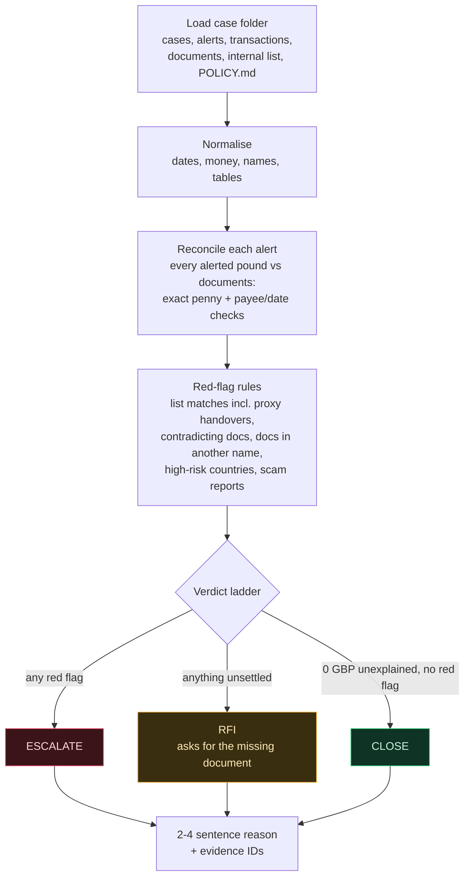
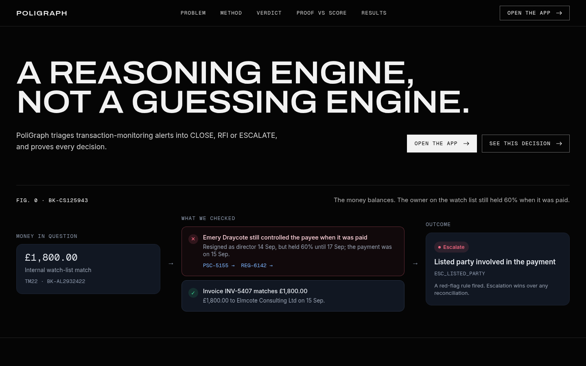
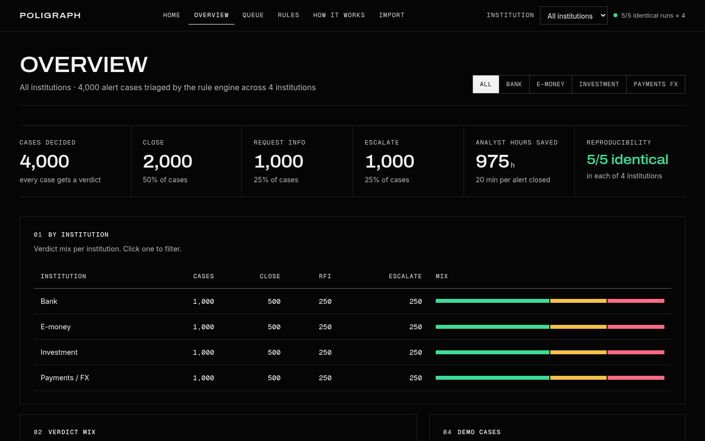
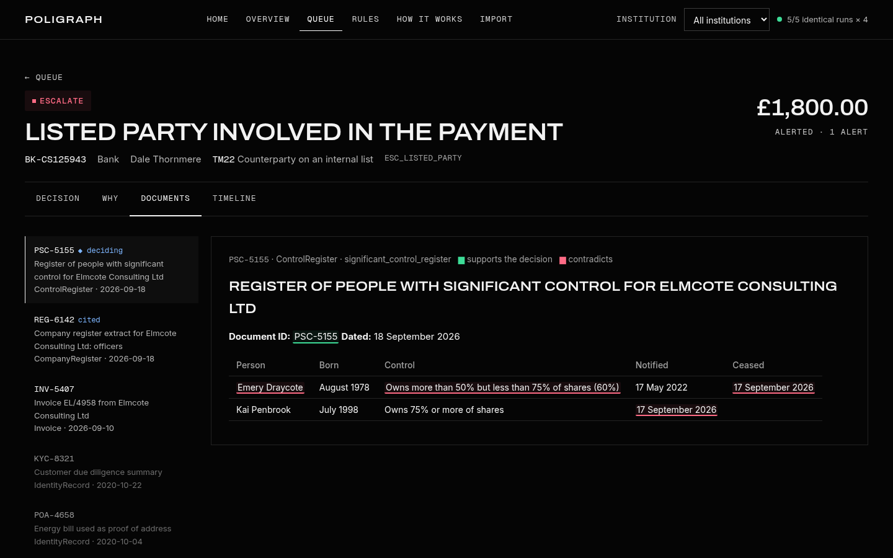
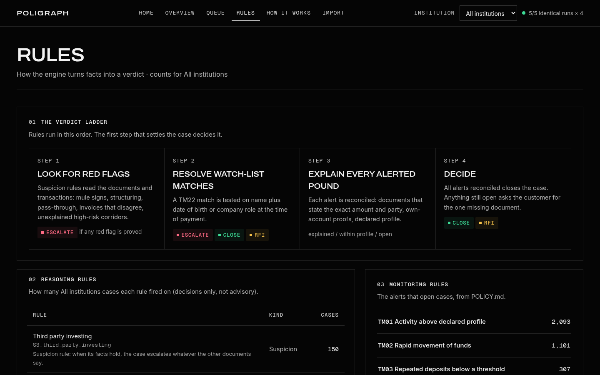

# PoliGraph

**A reasoning engine, not a guessing engine.** PoliGraph triages transaction-monitoring alerts into `CLOSE`, `RFI` or `ESCALATE` by reconciling every alerted pound against the documents on file and the institution's policy rules. It is deterministic and explainable, with no LLM and no network in the decision path, and every verdict cites its evidence IDs.

```bash
system/run institutions/bank output/bank.jsonl      # Python 3, no dependencies; ~1 s per 200 cases
```

- **How it decides:** [`system/README.md`](system/README.md). The full rule reference is in [`system/RULES.md`](system/RULES.md).
- **Outputs on the development cases:** [`output/`](output/) (`bank`, `emoney`, `investment`, `payments_fx` `.jsonl`).
- **Viewer:** open [`viewer/index.html`](viewer/index.html) locally; the landing page is [`viewer/landing.html`](viewer/landing.html).

## How it reasons



## Results

| | Development cases (4 × 1,000) | Independent adversarial set (120) |
|---|---|---|
| Verdicts | 500 CLOSE / 250 RFI / 250 ESCALATE per institution | 91/120 match the answer key (was 79) |
| Unsafe CLOSEs | no labels supplied | **0** (was 8) |
| Determinism | 5/5 byte-identical runs | 5/5 byte-identical runs |
| Speed | all 4,000 cases in ~12 s | under 1 s |

## What it looks like

**Landing page:** one real decision explained end to end.


**Overview:** all 4,000 dev cases across four institutions, with verdict mix and reproducibility.


**Case decision:** the exact scored reason, the £ reconciliation and every cited evidence ID.


**Why: story and rule graph.** The reasoning in plain steps, and as an ontology-typed knowledge graph.


**Documents:** the evidence with the facts the engine used highlighted.


**Rules:** the verdict ladder and every rule, with how many cases each one decided.

