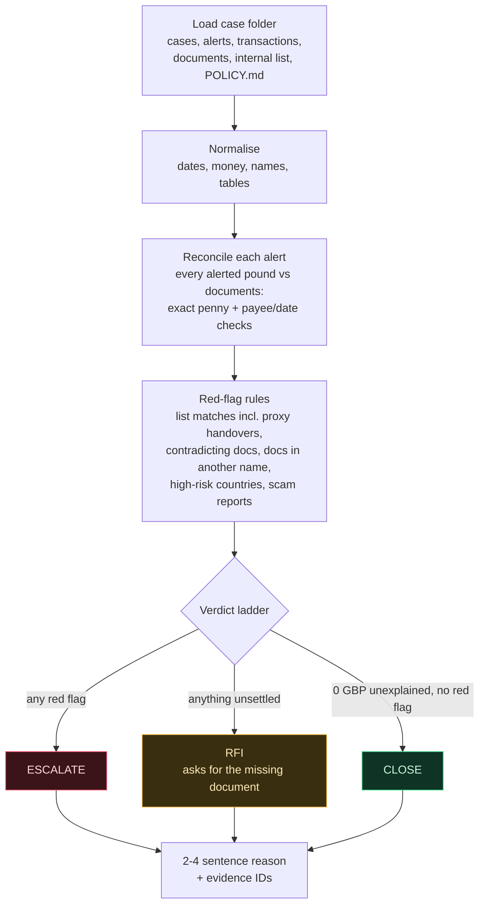
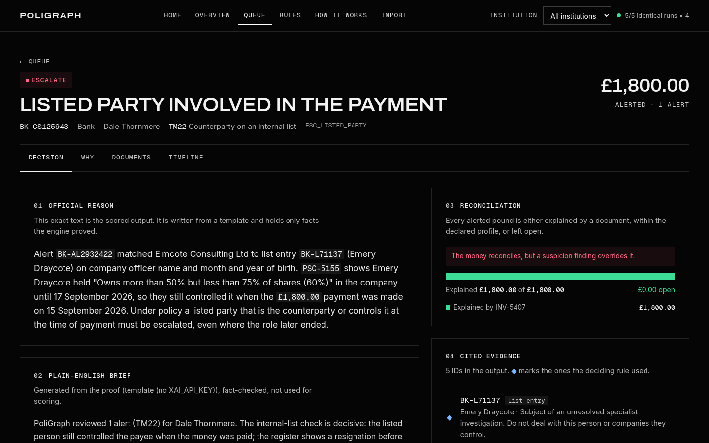
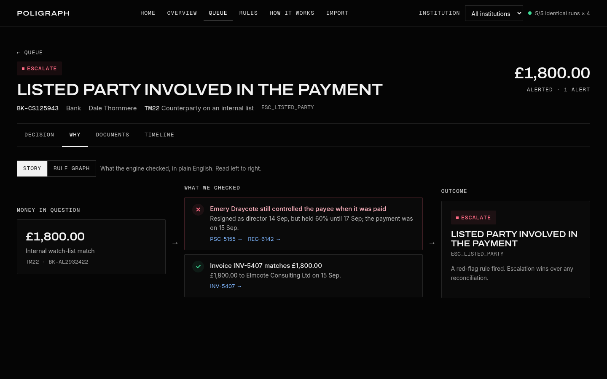
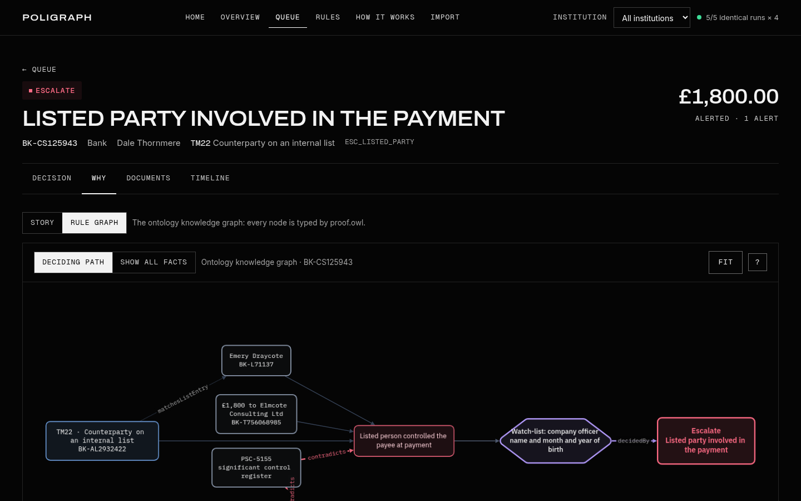

# PoliGraph

### A reasoning engine, not a guessing engine.

PoliGraph triages transaction-monitoring (TM) alerts into **CLOSE**, **RFI** (request for information) or **ESCALATE**. It does not predict a label. It **proves** each verdict: it reconciles every alerted pound against the documents in the case file and checks the institution's policy rules. Every sentence of every reason points to the evidence IDs it rests on, and you can open those documents in the app and see exactly which facts were used.

- **Judges' short spec, "how it decides":** [`system/README.md`](system/README.md)
- **Full rule reference:** [`system/RULES.md`](system/RULES.md)
- **Outputs on the development cases:** [`output/`](output/)

---

## The problem

An analyst working a TM alert has to answer one question: *is every pound that triggered this alert explained by something on file, and is anything on file a red flag?* The costs are lopsided. Closing a case that should have been escalated is far worse than asking one more question.

**Where predictor and LLM approaches fall short**
- **ML classifiers** learn surface patterns from labelled examples. They can't say *which document* explains *which payment*. They can drift on unseen institutions, and they can overfit the dev set.
- **LLM classifiers** can sound convincing while getting an amount, a date or a name wrong. Their output can change between runs, and a regulator can't replay their reasoning.
- **PoliGraph** decides with explicit, policy-grounded rules over facts it can cite. When it can't prove a case is clean, it doesn't guess. It asks (RFI) or escalates.

---

## How the reasoning works



1. **Read the policy and the case file.** That means the alerts, transactions, customer profile, evidence documents, internal list and earlier reviews. The institution type is taken from the data, else the folder name, else the `POLICY.md` heading. The engine reads only the folder it is given.
2. **Normalise.** Fixed, deterministic rules turn every format into one canonical form: dates, money ("£12k", "12 000,00"), names ("SMITH, John", "Mr J. Smith"), and tables, bullets and labels.
3. **Build the case graph.** Customers, accounts, transactions, alerts, documents, list entries, facts and rule firings become typed nodes and edges (`explains`, `supports`, `contradicts`, `matchesListEntry`, …). The types come from a formal OWL ontology, [`system/ontology/proof.owl`](system/ontology/proof.owl). With `--trace`, the engine writes the full proof as JSON plus an RDF knowledge graph (`<output>.kg.ttl`). [`system/tests/check_ontology.py`](system/tests/check_ontology.py) checks that everything emitted is defined in the ontology.
4. **Reconcile every alerted pound.** A transaction is explained only when a document matches it **to the penny** and names the right party. For example, an invoice must name the payee actually paid, an own-account statement must show the customer and the same account digits, and a booking must list the payer. Each alert clears only when what is still unexplained drops back under the threshold that fired it.
5. **Run the policy red-flag rules.** Each needs a concrete fact on file:
   - **Scam and mule signals:** a scam report tied to a payment, mule or third-party chats, structuring notes.
   - **Company red flags:** a payer company that was dissolved, pass-through to new companies, goods that don't fit the business.
   - **High-risk countries:** an undeclared high-risk country the client can't or won't explain.
   - **Internal-list matches:** confirmed by date of birth, address or control on the payment date, including **proxy handovers** where control passes to a relative days before the payment.
   - **Contradicting documents:** a car "sold" but insured again afterwards, a receipt in someone else's name, a group-company claim the register contradicts, a gift letter that names neither the payer nor the amount.
6. **Apply the verdict ladder.** Any proven red flag → **ESCALATE**. Anything unsettled → **RFI**, which asks for exactly the missing document. **CLOSE** only when £0 is unexplained and no red flag fired. A case that errors falls back to RFI or ESCALATE, never CLOSE.
7. **Write the reason.** 2–4 templated sentences with the case's own amounts, dates and IDs, and a reason code from the verdict's family. Every ID named in the reason is in `evidence`.

**Internal-list matches** are settled by who controlled the payee on the payment date. That diagram, and the full rule list, are in [`system/README.md`](system/README.md).

### Worked example: BK-CS125943
- **The alert.** Alert BK-AL2932422 matched the payee Elmcote Consulting Ltd to internal-list entry BK-L71137 (Emery Draycote).
- **What looks like a clearance.** Register REG-6142 shows Draycote resigned as director on 14 September 2026, the day before the £1,800 payment. On its own that would look like a different party.
- **What actually decides it.** Share register PSC-5155 shows Draycote still held **60% of the shares until 17 September**. The money also reconciles to invoice INV-5407, but a red flag outranks reconciliation.
- **Verdict:** **ESCALATE / ESC_LISTED_PARTY**, citing `BK-AL2932422, BK-L71137, BK-T756068985, PSC-5155, REG-6142`.


---

## Built for explainability

- **Every claim is traceable.** Each reason names the documents, transactions, alerts and list entries it relies on, and they are all in the output's `evidence` field.
- **There is a proof trace behind each verdict.** `--trace` records:
  - the facts, each with its source IDs
  - every rule that fired, and the facts it used
  - the £ reconciliation for each alert (alerted, explained, within profile, unexplained)
  - how each internal-list match was resolved
- **Same input, same bytes.** Repeated runs give byte-identical output (checked over 5 runs).
- **Policy-grounded reason codes.** Every verdict maps to a reason code from the right family (`CLOSE`, `RFI_*` or `ESC_*`), derived from the policy.
- **Easy to audit.** A reviewer can replay any case: open the documents, see the highlighted facts, follow the graph from the alert to the verdict.

## No LLM in the decision path

- **Verdicts, reason codes, reasons and normalisation are pure deterministic Python** in [`system/run`](system/run). It makes no network calls and loads no model.
- **One optional extra.** The viewer can show a *plain-English brief* for analysts, built by [`viewer/make_briefs.py`](viewer/make_briefs.py). By default it is a deterministic template. If an `XAI_API_KEY` is set, Grok can phrase it at temperature 0.
  - Every brief is **fact-checked against the proof**: each £ amount, record ID and proper name must appear in the proof. Briefs that fail are dropped.
  - Briefs are **never scored** and never affect a verdict.

---

## The visual app

A static, offline viewer: open `viewer/index.html`. It covers all 4,000 dev cases with no server and no build step.

| Screen | What it shows |
|---|---|
| **Landing** | Why PoliGraph is different, with one real decision explained step by step |
| **Overview** | Every case across 4 institutions, with an **All / Bank / E-money / Investment / Payments FX** switcher. Shows the verdict mix per institution and the reproducibility check |
| **Queue** | Searchable, filterable list of every case with its verdict and reason code |
| **Case › Decision** | The exact scored reason, the £ reconciliation bar (explained vs open), every cited evidence ID, and the plain-English brief |
| **Case › Why** | **Story** (the reasoning as plain steps) and **Rule graph** (the ontology-typed proof graph from alert to verdict, red/amber/green) |
| **Case › Documents** | The **actual source documents** from the case file. Facts that support the decision are highlighted **green** and contradictions **red** |
| **Case › Timeline** | Transactions, documents and alerts in date order |
| **Rules** | The verdict ladder and every rule, with how many cases each one decided |
| **How it works** | The method, in the app |
| **Import** | Runs the exact `system/run` in the browser via Pyodide (vendored WebAssembly Python) on your own folder, with policy what-ifs. Needs the folder served over HTTP |

**Overview:** 4,000 cases across four institutions.


**Case decision:** the scored reason, the reconciliation and the cited evidence.


**Why, story view:** the reasoning in plain steps.


**Why, rule graph view:** the proof as a knowledge graph.


**Documents:** the source register, with the deciding facts highlighted.


**Rules:** the ladder and how often each rule decided.


---

## Results

| | Development cases (4 × 1,000) | Independent adversarial set (120) |
|---|---|---|
| Verdicts | 500 CLOSE / 250 RFI / 250 ESCALATE per institution | **91 / 120** match the answer key (was 79) |
| Unsafe CLOSEs | no labels supplied, so no accuracy claimed | **0** (was 8); all remaining misses are cautious |
| Determinism | 5/5 byte-identical runs | byte-identical |
| Speed | 200 cases ≈ 1 s; all 4,000 ≈ 12 s with traces | < 1 s |

The adversarial set is 120 look-alike and trap cases from a teammate's independent generator. Rewording tests on the dev cases covered 18 families: ALL CAPS, name variants, EU money formats, US dates, dropped sentences and others. None of them turned a case into a CLOSE.

## Run it

```bash
# engine: Python 3, no dependencies
system/run institutions/bank output/bank.jsonl
system/run institutions/bank output/bank.jsonl --trace          # + proof trace and kg.ttl
system/run institutions/bank output/bank.jsonl --policy=p.json  # approved threshold override

# viewer: open directly, or serve to enable Import
open viewer/index.html            # or: python3 -m http.server -d viewer 8000
```

## Repo layout

```
system/run                 the engine (single file)
system/README.md           how it decides (short spec)
system/RULES.md            full rule, output and trace reference
system/ontology/proof.owl  ontology for the proof graph
system/tests/              ontology consistency check
output/                    outputs (+ traces) on the development cases
viewer/                    static app (index.html, landing.html, data/, vendor/)
landing-src/               source of the landing page (Vite + React)
docs/screenshots/          images used in this README
```

## Limits

- Rules fire only on what is written down. Judgement-heavy stories with no hard fact, such as some mule or account-takeover chats, tend to come out as RFI rather than ESCALATE.
- Exact-penny matching is deliberate: a few pence off (for example FX rounding) gives an RFI, not a CLOSE.
- Wording or document types the normaliser doesn't recognise lead to RFI, never to a guessed CLOSE.
