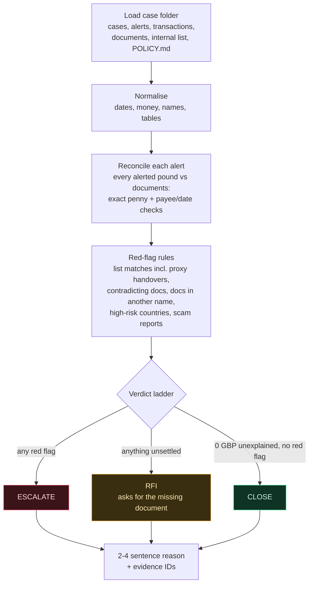
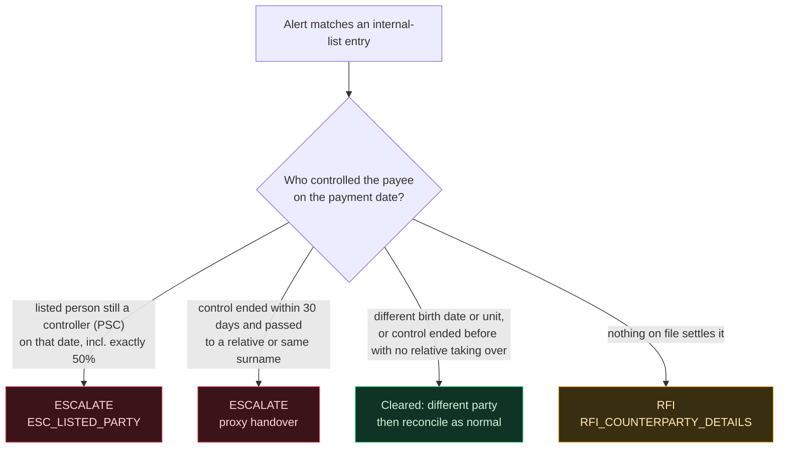
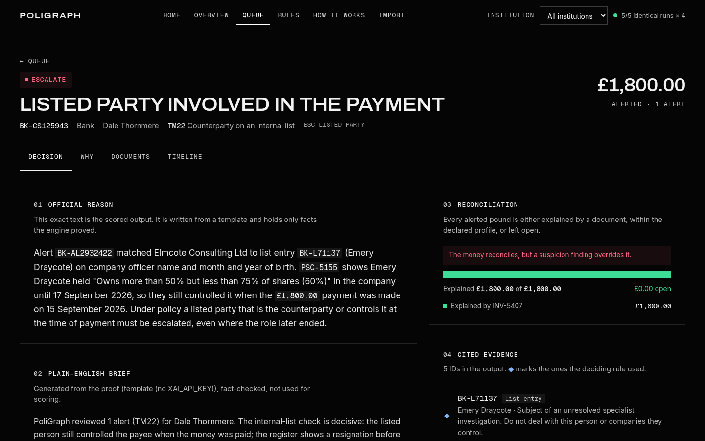
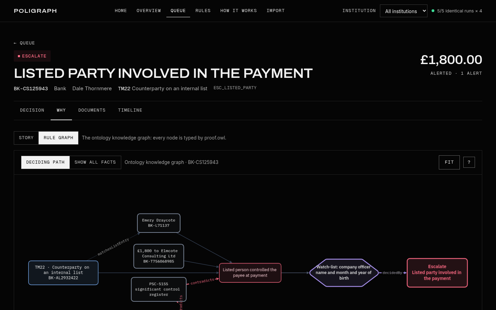

# PoliGraph: how it decides

**A reasoning engine, not a guessing engine.** PoliGraph triages transaction-monitoring alerts into `CLOSE`, `RFI` or `ESCALATE`. It does this by checking every alerted pound against the documents on file and against the institution's policy rules. It is a single Python 3 file with no dependencies. It is deterministic, uses no LLM and no network, reads only the folder it is given and writes only its output file.

```bash
system/run institutions/bank output/bank.jsonl                 # one line per case, in cases.jsonl order
system/run institutions/bank output/bank.jsonl --trace         # optional: full reasoning trace + knowledge graph
system/run institutions/bank output/bank.jsonl --policy=p.json # optional: an approved threshold override
```
Speed: 200 cases take about 1 s and 1,000 cases about 2.5 s. All 4,000 dev cases, with traces, take about 12 s, against a 30-minute budget.

## 1. How it reasons


1. **Read the case.** Load the customer, the alerts, the transactions, the evidence documents, the internal list and earlier reviews. The engine opens only files inside the institution folder.
2. **Normalise.** Turn every format into one canonical form with fixed rules (no model involved). This covers dates ("3rd Oct", US dates only when unambiguous), money ("£12k", "12 000,00"), names ("SMITH, John", "Mr J. Smith") and table or bullet layouts.
3. **Reconcile each alert.** A transaction counts as explained only when a document on file matches it to the penny and names the right party. For example, an invoice must name the payee actually paid, an own-account statement must show the customer as holder with the same account digits, and a booking must list the payer. Items within the declared profile, such as salary from the declared employer, also count. An alert clears only when what is still unexplained falls back under the threshold that fired it.
4. **Run the red-flag rules.** Each rule needs a concrete fact on file. The rules cover:
   - a scam report tied to a payment
   - a mule or third-party chat
   - a structuring note
   - a payer company dissolved before it paid
   - pass-through to new companies
   - an undeclared high-risk country the client can't or won't explain
   - goods that don't fit the business
   - an internal-list match confirmed by date of birth or address, or by control on the payment date. This includes **proxy handovers**, where control passes to a relative days before the payment.
   - **contradicting documents**, such as a car "sold" but insured by the customer again afterwards
   - a **receipt in another person's name**
   - a **group-company claim the register contradicts**
   - a gift letter or completion statement that names neither the payer nor the amount
5. **Apply the verdict ladder.** Any red flag means **ESCALATE**. Anything unsettled means **RFI**: an open alert, missing data, an unmatched scam report, or dormant money with no evidenced source. The RFI asks for exactly the missing document. **CLOSE** is reached only when every alert reconciles with £0 unexplained and no red flag. A wrong CLOSE is the costliest error, so the engine never closes on a guess. If a case errors, it falls back to RFI or ESCALATE, never CLOSE.
6. **Write the reason.** The reason is 2–4 templated sentences giving this case's amounts, dates and document IDs. Every ID it names is in `evidence`.

**Internal-list matches** are settled by who controlled the payee on the payment date:



**Worked example (dev case BK-CS125943).** Alert BK-AL2932422 matched payee Elmcote Consulting Ltd to list entry BK-L71137 (Emery Draycote) on officer name and birth month. Register REG-6142 shows Draycote resigned as director on 14 September 2026, the day before the payment, which on its own would look like a different party. But PSC register PSC-5155 shows Emery Draycote still held 60% of the shares until 17 September 2026. The £1,800 payment was on 15 September. Policy says a listed party controlling the payee at the time of payment must be escalated, so the verdict is → `ESCALATE / ESC_LISTED_PARTY`, evidence `BK-AL2932422, BK-L71137, BK-T756068985, PSC-5155, REG-6142`.

## What it looks like

The viewer (`viewer/index.html`, works offline from file://) shows every case with its reason, £ reconciliation, evidence and reasoning graph.

| Case decision | Reasoning graph |
|---|---|
|  |  |

More screenshots: [repo README](../README.md#what-it-looks-like).

## 2. Why this approach

- **Every verdict is traceable.** Each decision cites the policy rule that fired and the exact evidence IDs and amounts it rests on. `--trace` exports the facts, rule firings and per-alert £ reconciliation as JSON and as an RDF graph against `ontology/proof.owl`. A reviewer or regulator can follow the reasoning line by line.
- **Nothing to overfit.** There is no trained model. The rules come from POLICY.md and general financial-crime patterns, and no dev case IDs, names or amounts are hard-coded. ML predictors and LLM classifiers learn surface patterns from the dev set and can drift on unseen cases. They can't show why they decided.
- **Reproducible.** The same input always gives byte-identical output, checked over 5 repeated runs. There are no prompts, temperatures or API outages, and no risk of invented facts in the scored path.
- **Built around the scoring's unequal costs.** Uncertainty always resolves upward, to RFI or ESCALATE. CLOSE requires positive proof.
- **Ready for new institutions.** The institution type is read from the data or the POLICY.md heading. Thresholds can be changed per institution with an approved `--policy` file, and folder names are not assumed.

## 3. Results

- **Development cases (4 × 1,000).** Each institution comes out at 500 CLOSE, 250 RFI and 250 ESCALATE. Output is spec-valid on every line. Two runs are byte-identical, and renaming folders changes nothing. The dev cases have no answer labels, so we quote no accuracy for them.
- **Independent adversarial set.** These are 120 hand-written look-alikes and traps from a teammate's generator, scored against its answer key.
  - Before the latest round: 79/120 verdicts right, with **8 unsafe CLOSEs**.
  - Now: **91/120 right and 0 unsafe CLOSEs**. The 29 misses are all cautious: 20 escalations answered as RFI, and 9 closes answered as RFI.
  - The dev outputs stayed byte-identical through this change.
- **Robustness.** 18 rewording families were tested on the dev cases: ALL CAPS, name variants, EU money formats, US dates, dropped sentences, reordered labels and others. **No perturbation turned a case into a CLOSE.** The only effect is that some closes become RFI.

## 4. Known limits

- Rules only fire on what is written down. Judgement-heavy patterns with no hard fact, such as some mule, account-takeover or smurfing stories told only through chat tone, tend to come out as RFI rather than ESCALATE.
- Exact-penny matching is deliberate. A payment a few pence off, for example from FX rounding, gives an RFI rather than a CLOSE.
- New document types or unusual wording that the normaliser doesn't recognise lead to RFI, not to a wrong CLOSE.

Full rule reference, output fields, trace format and ontology: [`RULES.md`](RULES.md).
